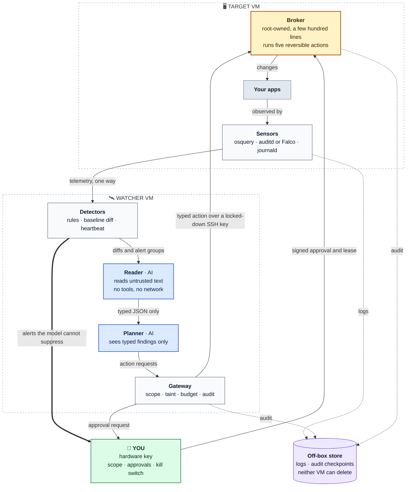
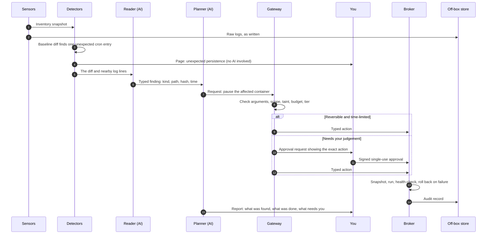
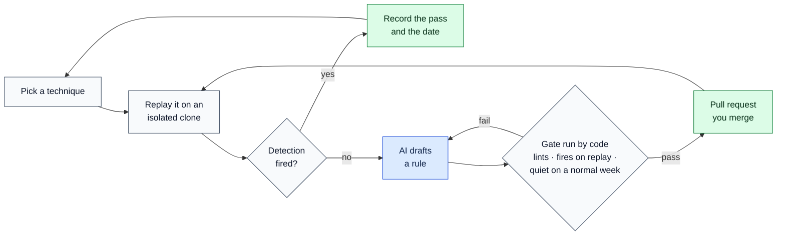
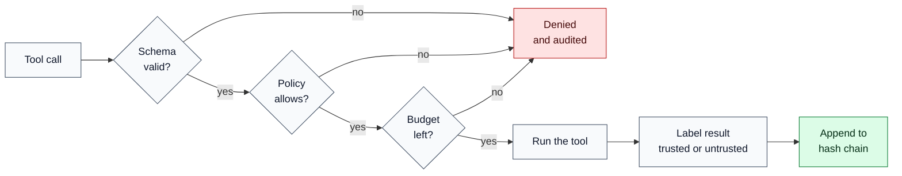

<div align="center">

# Arbor

**A self-hosted security agent for the Linux servers you own.**

It watches the box, explains what changed in plain language,<br>
and acts only through a short list of reversible actions you approve.

[](https://github.com/Thunderk3g/Arbor/actions/workflows/ci.yml)


[](LICENSE)

[Quick start](#quick-start) · [How it works](#how-it-works) · [Features](#features) · [Roadmap](#roadmap) · [Design research](reports/Arbor%20self%20hosted%20security%20agent.md)

</div>

> [!NOTE]
> **Where it stands:** the design is complete and the safety kernel (gateway, approval tokens, audit chain) is built and tested. The security agent itself is not built yet. `./run.sh` runs the kernel and its demo; it does not watch or change the machine it runs on.

<br>

## Quick start

```bash
git clone https://github.com/Thunderk3g/Arbor.git && cd Arbor && ./run.sh
```

One command sets up a virtual environment, installs the dependencies, runs the 219 tests and then the demo. The first run takes about 15 seconds; later runs skip the setup. Needs Python 3.12 or newer on macOS or Linux.

| Command | What it does |
|:--|:--|
| `./run.sh` | Set up, run the tests, run the demo |
| `./run.sh test` | Run only the tests |
| `./run.sh demo` | Run only the demo |
| `./run.sh api` | Serve the API on `http://127.0.0.1:8000` |
| `docker compose up --build` | Serve the API from a container, on any platform |

<details>
<summary><b>Run it without the script</b> (Windows, or step by step)</summary>

<br>

`pytest.ini` and `scripts/run_demo.py` put the package roots on the path themselves, so there is no install step.

```bash
python -m venv .venv
# Windows:        .venv\Scripts\activate
# macOS / Linux:  source .venv/bin/activate

pip install -r requirements.txt
pytest                       # 219 tests
python scripts/run_demo.py   # demo; prints a report and exits 0
```

To serve the API by hand, put the seven package roots on `PYTHONPATH`:

```bash
# macOS / Linux
PYTHONPATH=backend/audit:backend/approval:backend/gateway:graph/ontology:graph/focal:memory:platform \
  uvicorn r2pip_platform.app:app --host 127.0.0.1 --port 8000
```

```powershell
# Windows PowerShell
$env:PYTHONPATH = "backend/audit;backend/approval;backend/gateway;graph/ontology;graph/focal;memory;platform"
uvicorn r2pip_platform.app:app --host 127.0.0.1 --port 8000
```

Endpoints: `GET /health`, `GET /tools`, `POST /missions/run`, `GET /audit/verify`.

To run the demo in a container instead:

```bash
docker build -t arbor . && docker run --rm arbor
```

> [!WARNING]
> The API has no authentication. `./run.sh api` and the commands above listen on this machine only. `docker compose up` publishes port 8000 on all network interfaces, so use it only on a machine or network you trust.

</details>

<br>

## Three rules

| 🔍 Code notices, the model explains | 🔒 The model has the least access | 🔑 You hold the keys |
|:--|:--|:--|
| Fixed checks (baseline diffs, canary tokens, blocked connections) detect problems. The model reads their output and explains it. It cannot suppress an alert. | The model runs on a separate machine with no standing credentials. If a poisoned log line tricks it, the worst outcome is a wrong summary. | The list of systems in scope, every approval and the kill switch are signed on a device the agent cannot reach. |

<br>

## How it works



<sub>🟦 contains an AI model · ⬜ ordinary code · 🟨 the only privileged code · 🟩 a person · 🟪 off-box storage · everything on the watcher VM runs unprivileged</sub>

| Part | Runs on | AI | What it does |
|:--|:--|:--:|:--|
| **Sensors** | Target | — | Record processes, logins, open ports, users, scheduled jobs, SSH keys, packages, containers |
| **Detectors** | Watcher | — | Compare each snapshot with a known-good baseline, fire fixed rules, page you directly for high-severity events |
| **Reader** | Watcher | ✓ | Read attacker-controlled text (logs, HTTP responses, scanner output) and turn it into typed findings. No tools, no network |
| **Planner** | Watcher | ✓ | Decide what to investigate, propose actions, write the report. Never sees raw untrusted text |
| **Gateway** | Watcher | — | Check every request for valid arguments, scope, taint, budget and autonomy tier; write an audit record before and after |
| **Broker** | Target | — | Check the kill-switch lease and approval signature, snapshot, run one fixed command, health-check, roll back on failure |
| **Red sandbox** | Watcher | ✓ | Run scans and attack replays. Its network reaches only the addresses in your signed scope file |
| **Off-box store** | Elsewhere | — | Keep logs, drift manifests and audit checkpoints where the VMs can add but not delete |

The broker's action list is everything the agent can change: `notify`, `upgrade_package`, `restart_unit`, `block_ip` and `pause_container`, each with a tested undo.

### When something changes on the server

An intruder adds a scheduled job to keep access:



You are paged at step 4, before any AI is involved, and nothing later can cancel that page. After a confirmed break-in the plan is snapshot, contain, rebuild from declared configuration and rotate credentials by hand. In-place cleanup is deliberately not an action.

<br>

## Features

<sub>✅ Built and tested · 🟡 Partial: works, but not yet a security boundary · ⚪ Planned</sub>

### What the agent will do

| | Capability | What it does | Who does the work | Phase |
|:--:|:--|:--|:--|:--:|
| ⚪ | **Watch** | Processes, connections, logins and SSH, users and sudo, scheduled jobs, open ports, packages, containers | Sensors | 0 |
| ⚪ | **Detect drift** | Diff against a known-good baseline: cron, systemd units, startup scripts, SSH keys, sudoers, SUID files, kernel modules | Code | 0 |
| ⚪ | **Catch silent attacks** | Canary tokens, decoy keys and files, logged outbound blocks, alert when telemetry stops | Code | 0 |
| ⚪ | **Keep evidence safe** | Ship logs and audit checkpoints off the server as they are written | Code | 0 |
| ⚪ | **Patch** | Apply distribution security updates automatically and verify they ran | Code | 0 · 3 |
| ⚪ | **Explain** | Plain-language reports: what was found, what was done, why, what needs you | AI | 2 |
| ⚪ | **Investigate** | Group alerts, build a timeline, attach the evidence | AI, read-only | 2 |
| ⚪ | **Contain** | Reversible, time-limited actions: block an address, pause a container, restart a service | Broker | 3 |
| ⚪ | **Fix** | Code and configuration fixes as pull requests, accepted only when the original attack and its variants fail and tests pass | AI proposes, you merge | 3 |
| ⚪ | **Harden CI/CD** | Pull requests that pin actions, cut token permissions and add dependency cooldowns | AI proposes, you merge | 3 |
| ⚪ | **Red team** | Safe scans on production; real exploits only against an isolated clone | Red sandbox | 4 |
| ⚪ | **Purple team** | Replay a technique, check a detection fired, draft a rule if not, gate it mechanically | Code gates, AI drafts | 4 |
| ⚪ | **Cloud posture** | Identity and permission checks for the accounts the server depends on | Scanners | 5 |

### The safety kernel

| | Mechanism | Purpose | Today |
|:--:|:--|:--|:--|
| 🟡 | **Tool gateway** | One checkpoint for every call: validate, apply policy, budget, log | Pipeline built and tested; runs in the same process as the caller |
| 🟡 | **Policy rules** | Allow or deny each call | Six ordered rules with default deny; no host or repo allowlist yet |
| 🟡 | **Taint firewall** | Stop attacker-controlled text from steering actions | Blocking rule exists; taint is supplied by the caller, not yet tracked |
| 🟡 | **Approval tokens** | An approval covers one exact action, once | Signed, expiring, single-use, bound to an argument hash; tool name and key placement still to fix |
| 🟡 | **Audit chain** | Reconstruct who did what | Correct SHA-256 hash chain and verifier, in memory; no off-box anchor yet |
| 🟡 | **Budgets** | Cap how much an agent can do | Atomic check-and-consume; unmetered by default |
| 🟡 | **Risk tiers** | Riskier actions wait for a person | Score computed; no code path depends on it yet |
| 🟡 | **Evidence check** | A finding must cite its evidence | Checks a citation exists, not that it supports the claim |
| ✅ | **Graph schema** | Typed schema for assets, findings and evidence | Loader and validator built and tested |
| ✅ | **Focal extraction** | Pick the relevant slice of the graph for a task | Deterministic and tested |
| ✅ | **Prompt assembler** | Build prompts with untrusted content fenced off | Deterministic and budgeted |
| ⚪ | **Broker** | The only privileged code, small enough to read in one sitting | Phase 1 |
| ⚪ | **Scope enforcement** | Out-of-scope targets unreachable, in the gateway and in the network | Phases 1 and 4 |
| ⚪ | **Kill switch** | A short lease you renew; without it the broker refuses to act | Phase 1 |
| ⚪ | **Off-box audit anchor** | Detect a rewritten or truncated log | Phase 1 |
| ⚪ | **Agent loop** | The AI planner and reader | Phase 2 |

<br>

## How much it may do on its own

Two questions set the tier: who wrote the change, and can it be undone.

| Tier | When | Examples |
|:--|:--|:--|
| 🟢&nbsp;**Automatic** | Read-only | Scans, audits, checking that updates ran, reproducing an exploit on a copy, opening issues |
| 🔵&nbsp;**With&nbsp;a&nbsp;net** | From a trusted upstream, or reversible and time-limited. Snapshot first, health check after, automatic rollback | Distribution security updates, restarting a non-critical service, a temporary address block, pausing a flagged container |
| 🟠&nbsp;**You&nbsp;approve** | Written by AI, touches how you get in, or needs judgement | Code fixes, dependency bumps, reboots, SSH and firewall changes, killing processes, locking users |
| 🔴&nbsp;**Never** | One-way doors | Deleting data, logs or backups; rotating credentials; cleanup after a break-in; changing the agent's own permissions; disabling a security control |

### If the AI is tricked

| It can | It cannot |
|:--|:--|
| Write a wrong summary<br>Request an action that policy already allows, within rate limits | Reach a system outside the signed scope<br>Approve its own request or silence an alert<br>Erase or rewrite the record of what it did |

<br>

## Attack, check, fix, repeat

A list of attack techniques, each with the date it last passed. A rule the AI drafts is accepted only by a mechanical gate, because a rule can look right and match nothing.



Real exploits run only on the clone, whose network is isolated before first boot. Production gets safe, detection-grade scans.

<br>

## What runs today

About 4,000 lines of Python in seven packages, in one process and in memory. Every tool call goes through the gateway pipeline in [`backend/gateway/r2pip_gateway/gateway.py`](backend/gateway/r2pip_gateway/gateway.py):



The demo drives a scripted change through four human approval gates, shows the taint firewall blocking a poisoned write, and verifies the audit chain at the end. Agents are scripted and most tools are stand-ins; there is no AI model in the loop yet.

<details>
<summary><b>Packages</b></summary>

<br>

| Package | Directory | Holds |
|:--|:--|:--|
| `r2pip_gateway` | `backend/gateway` | Tool registry, schema check, policy rules, budgets, the pipeline above |
| `r2pip_approval` | `backend/approval` | Signed, single-use approval tokens |
| `r2pip_audit` | `backend/audit` | Hash-chained audit log and verifier |
| `r2pip_ontology` | `graph/ontology` | Graph schema loader and validator |
| `r2pip_focal` | `graph/focal` | Focal graph extraction |
| `r2pip_memory` | `memory` | Prompt assembler, claim checks, session memory |
| `r2pip_platform` | `platform` | Scripted agents, orchestrator, stand-in tools, demo, API |

</details>

<br>

## Roadmap

Each phase ends with an exit check, and the next starts only when it passes.

| Phase | Weeks | Goal | AI |
|:--|:--:|:--|:--:|
| **0 · Boring box** | 1–2 | Close ports, automatic security updates, outbound default-deny, off-box logs, drift baseline, canaries, CI hygiene | — |
| **1 · Trust kernel** | 3–6 | Gateway, signer and audit writer as separate processes; broker with five actions; signed scope file; off-box audit anchors; kill switch | — |
| **2 · Read-only interpreter** | 7–10 | Watcher VM with reader and planner. The AI explains diffs and alerts; its only action is `notify` | ✓ |
| **3 · First actions** | 11–14 | Reversible actions with snapshot and health check; a GitHub App that opens pull requests | ✓ |
| **4 · Red on a clone** | 15–20 | Isolated clone pipeline, safe production scans, rule acceptance gate in CI | ✓ |
| **5 · Optional** | later | Cloud checks, security graph, local model, more actions; each must move a measured number | ✓ |

The full plan, with the first two weeks day by day, is in the [design research](reports/Arbor%20self%20hosted%20security%20agent.md).

<br>

## Repository

```text
backend/gateway     tool gateway: schema, policy, budgets
backend/approval    signed single-use approval tokens
backend/audit       hash-chained audit log
graph/              graph schema and focal extraction
memory/             prompt assembler, claim checks, session memory
platform/           scripted agents, orchestrator, demo, API
docs/               architecture decision records
reports/            design research behind this README
research_notes/     source notes for the research
run.sh              one-command runner
```

<br>

<div align="center">
<sub>MIT licensed · see <a href="LICENSE">LICENSE</a></sub>
</div>
