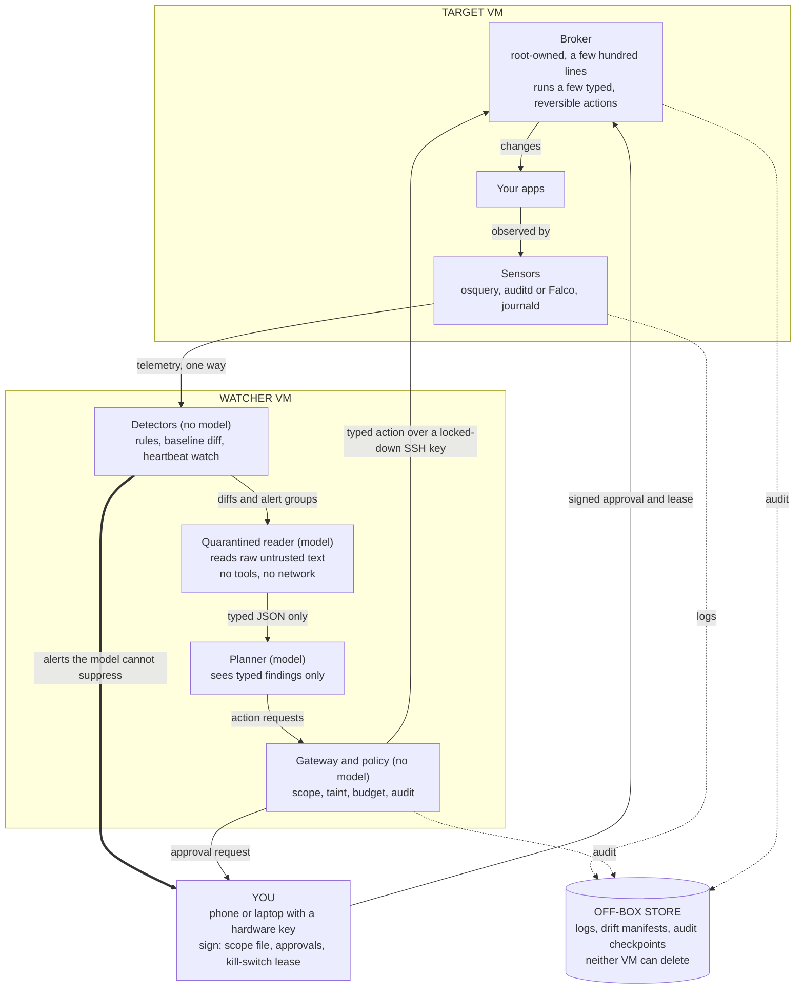
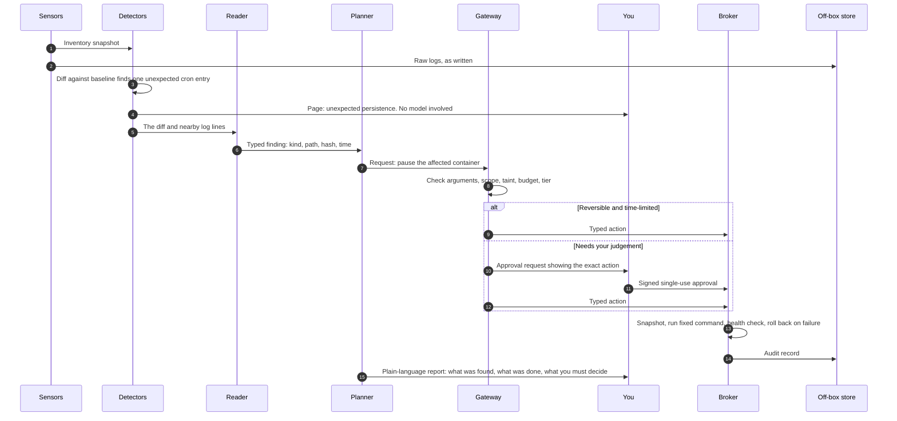
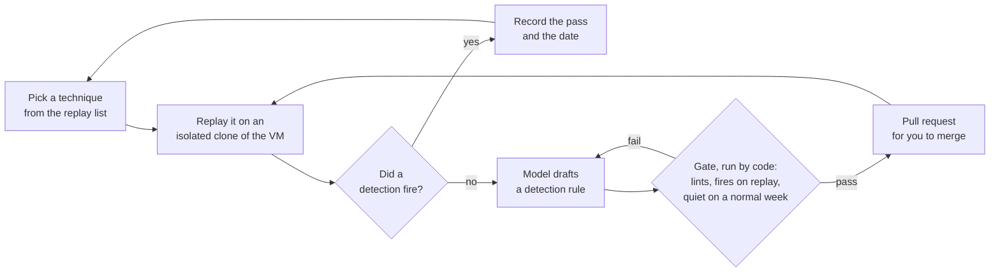
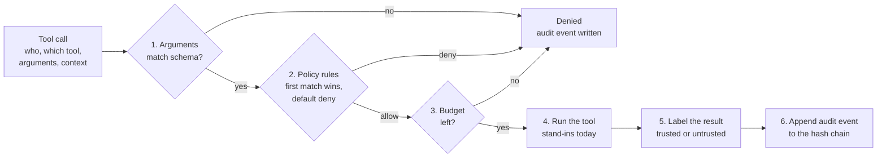
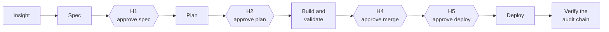

# Arbor

A self-hosted security agent for a Linux VM you own: it watches the box, explains
what changed, and acts only through a short list of typed, reversible actions.

> **Status: design plus a reference safety kernel. No security agent runs yet.**
> The agent described below is the planned design from the
> [research report](reports/Arbor%20self%20hosted%20security%20agent.md).
> What runs today is a tested, in-memory Python reference implementation
> (219 tests) with scripted agents and stand-in tools. Every feature in this
> README is marked **Built**, **Partial** or **Planned**.

Arbor began as a "research to product" agent platform (RFC-001). That use case
is dropped. The safety machinery is being kept and rebuilt around a security
agent; the original RFC is kept under [Background](#background-the-original-rfc).

## Run it in one command

From a fresh clone, on macOS or Linux with Python 3.12 or newer:

```bash
./run.sh
```

This creates a virtual environment, installs the dependencies, runs the 219
tests, and then runs the demo mission, which prints a report and exits. The
first run takes about 15 seconds; later runs skip the setup.

It runs the **reference implementation**: scripted agents and stand-in tools
going through the real gateway, approval tokens and audit chain. It does not
start a security agent, and it does not watch or change the machine it runs on.

| Command | What it does |
|---|---|
| `./run.sh` | Set up, run the tests, run the demo |
| `./run.sh demo` | Run only the demo |
| `./run.sh test` | Run only the tests |
| `./run.sh api` | Serve the API on `http://127.0.0.1:8000` |

With Docker instead, on any platform including Windows:

```bash
docker compose up --build
```

That builds the image and serves the same API on port 8000. More options are
under [Running the reference implementation](#running-the-reference-implementation).

## Contents

- [Run it in one command](#run-it-in-one-command)
- [The idea in one picture](#the-idea-in-one-picture)
- [How the agent works](#how-the-agent-works)
- [What happens when something changes on the VM](#what-happens-when-something-changes-on-the-vm)
- [Features](#features)
- [How much the agent may do on its own](#how-much-the-agent-may-do-on-its-own)
- [Attack, check, fix, repeat](#attack-check-fix-repeat)
- [What runs today](#what-runs-today)
- [Build plan](#build-plan)
- [Running the reference implementation](#running-the-reference-implementation)
- [Background: the original RFC](#background-the-original-rfc)

## The idea in one picture

Three rules shape everything else:

1. **Code notices, the model explains.** Deterministic checks (baseline diffs,
   canary tokens, blocked outbound connections) detect problems. The model reads
   their output and tells you what it means. It is never the first line of
   detection, and it cannot suppress an alert.
2. **The model is the least privileged part.** It runs on a separate small VM
   with no standing credentials on the target. A model that has been hijacked by
   a poisoned log line can, at worst, write a wrong summary or request an action
   that policy already allows.
3. **You hold the keys.** The list of systems in scope, every approval, and the
   kill switch are signed on a device neither VM can reach.



The target VM runs your apps. The watcher VM runs everything that contains a
model, as unprivileged users. A red sandbox for scans and attack replays also
lives on the watcher VM (not drawn); its network can reach only in-scope
addresses.

## How the agent works

Each part has one job, and the split between them is the security design.

| Part | Runs on | Uses a model? | What it does | If it is compromised |
|---|---|---|---|---|
| **Sensors** | Target VM | No | Collect process events, logins, listening ports, users, scheduled jobs, SSH keys, packages, containers | An attacker with root can silence them, which is why a missing heartbeat is itself an alert |
| **Detectors** | Watcher VM | No | Compare each snapshot with the known-good baseline; fire fixed rules; page you directly for the highest-severity events | Fixed rules have no text to trick |
| **Quarantined reader** | Watcher VM | Yes | Reads attacker-controlled text (logs, HTTP responses, scanner output) and turns it into typed findings | It has no tools and no network, so it can only emit a wrong finding |
| **Planner** | Watcher VM | Yes | Decides what to investigate, what to propose, and what to tell you. Never sees raw untrusted text | It can only request actions from the broker's list |
| **Gateway and policy** | Watcher VM | No | Checks every request: valid arguments, target in scope, taint, budget, autonomy tier. Writes an audit record before and after | It holds no credentials for the target on its own; the broker re-checks |
| **Broker** | Target VM | No | Root-owned and tiny. Checks the kill-switch lease and the approval signature, takes a snapshot, runs one fixed command, checks health, rolls back on failure | The only privileged code, so it is kept small enough to read in one sitting |
| **Red sandbox** | Watcher VM | Yes | Runs scans and attack replays. Its network can reach only the addresses in your signed scope file | Out-of-scope packets are dropped by the network, whatever the model decides |
| **Off-box store** | Elsewhere | No | Receives logs, drift manifests and audit checkpoints as they are written | Write-only credential: the VMs can add, not delete |

The broker's action list is the whole of what the agent can change. The planned
first version has five: `notify`, `upgrade_package`, `restart_unit`, `block_ip`
and `pause_container`. Each has a tested undo.

## What happens when something changes on the VM

A worked example: an attacker who got in adds a scheduled job to keep access.



Step 4 happens before any model is involved, and nothing the model does later
can cancel it. In-place cleanup after a confirmed break-in is deliberately not
on the action list: the plan is to snapshot, contain, rebuild the VM from its
declared configuration, and rotate credentials by hand.

## Features

**Status key.** **Built**: works in the reference code today. **Partial**: the
core exists and is tested, but it is not yet a real security boundary.
**Planned**: designed, not written.

### Security capabilities

None of these exist yet. The phase numbers refer to the [build plan](#build-plan).

| Capability | What it will do | Who does the work | Status |
|---|---|---|---|
| **Watch** | Processes, network connections, logins and SSH, users and sudo, scheduled jobs, open ports, packages, containers | Sensors, no model | Planned, phase 0 |
| **Detect drift and persistence** | Diff each snapshot against a known-good baseline: cron, systemd units, startup scripts, SSH keys, sudoers, SUID files, kernel modules | Code | Planned, phase 0 |
| **Catch silent attacks** | Canary tokens, decoy keys and files, logging of blocked outbound connections, alert when telemetry stops | Code | Planned, phase 0 |
| **Keep evidence safe** | Ship logs and audit checkpoints off the VM as they are written, to storage the VM cannot delete from | Code | Planned, phase 0 |
| **Patch** | Apply the distribution's security updates automatically; the agent verifies they ran | Code, model reports | Planned, phase 0 and 3 |
| **Explain** | Plain-language reports: what was found, what was done, why, and what needs you | Model | Planned, phase 2 |
| **Investigate alerts** | Group and correlate alerts, build a timeline, attach the evidence | Model, read-only | Planned, phase 2 |
| **Contain** | Reversible, time-limited actions: block an address, pause a container, restart a service | Broker, on request | Planned, phase 3 |
| **Fix code and config** | Pull requests only. A fix counts when the original attack fails, variants fail, and tests pass | Model proposes, you merge | Planned, phase 3 |
| **Harden CI/CD** | Pull requests that pin actions, cut token permissions and add dependency cooldowns. Never touches secrets, triggers or branch protection | Model proposes, you merge | Planned, phase 3 |
| **Red team** | Safe, detection-grade scans on production. Real exploits only against an isolated clone | Red sandbox | Planned, phase 4 |
| **Purple team** | Replay a technique, check a detection fired, draft a rule if not, gate the rule mechanically | Code gates, model drafts | Planned, phase 4 |
| **Cloud posture** | Identity and permission checks for the accounts the VM depends on | Scanners, model reports | Planned, phase 5, optional |

### Safety machinery

| Mechanism | What it is for | State of the code today | Status |
|---|---|---|---|
| **Tool gateway** | One checkpoint for every tool call: validate, apply policy, budget, log | The pipeline is real and tested. It runs in the same process as the agent, so a direct call to a tool skips it | Partial |
| **Policy rules** | Decide allow or deny per call | Six hard-coded rules, first match wins, default deny. No allowlist of hosts, repos or accounts yet | Partial |
| **Taint firewall** | Stop text an attacker controls from steering actions | The blocking rule exists. Taint is a label the caller sets, not something tracked from what was read | Partial |
| **Approval tokens** | Your approval covers one exact action, once | Signed, expiring, single-use, bound to a hash of the arguments. The tool name is not in the hash, and the signing key lives in the agent's process | Partial |
| **Audit chain** | Reconstruct who did what | Correct SHA-256 hash chain and verifier, held in memory. Nothing anchors it off the machine | Partial |
| **Budgets** | Cap how much an agent can do | Atomic check-and-consume. Unmetered by default, no time windows | Partial |
| **Risk score and autonomy tier** | Riskier actions wait for you | A score is computed and printed. No code path depends on it | Partial |
| **Grounded-claim check** | A finding needs evidence | Confirms a claim cites a successful tool call, not that the call supports the claim | Partial |
| **Ontology loader and validator** | Typed knowledge graph schema | Works and is domain-neutral. The schema content is still research-shaped | Built |
| **Focal graph extraction** | Pick the relevant slice of the graph for a task | Deterministic and tested. Profiles are still research-shaped | Built |
| **Prompt assembler** | Build prompts with untrusted content fenced off | Deterministic and budgeted. The fence marker is not escaped yet | Built |
| **Broker with typed actions** | The only privileged code | Not written | Planned, phase 1 |
| **Scope enforcement** | Make out-of-scope targets unreachable, in the gateway and again in the network | Not written | Planned, phase 1 and 4 |
| **Kill switch** | A short-lived lease you renew; without it the broker refuses to act | Not written | Planned, phase 1 |
| **Off-box audit anchor** | Detect a rewritten or truncated log | Not written | Planned, phase 1 |
| **Model loop** | The agent itself | Not written. Today's agents are scripted and 14 of 17 tools are stand-ins | Planned, phase 2 |

The file and line evidence for the "today" column is in the report's
keep / change / drop table.

## How much the agent may do on its own

Two questions decide the tier: who wrote the change, and can it be undone.

| Tier | Rule | Examples |
|---|---|---|
| **0. Always automatic** | Read-only | Scans, audits, checking that updates ran, reproducing an exploit on a copy, opening issues |
| **1. Automatic, with a safety net** | Written by a trusted upstream, or trivially reversible and time-limited. Snapshot first, health check after, automatic rollback, rate limit | Distribution security updates, restarting a non-critical service, a temporary address block, pausing a flagged container |
| **2. Agent prepares, you approve** | Written by a model, or touches how you get in, or needs judgement | All code fixes, dependency bumps, reboots, SSH and firewall changes, killing processes, locking users |
| **3. Never automated** | One-way doors | Deleting data, logs or backups; rotating credentials; cleanup after a confirmed break-in; changing the agent's own permissions or audit log; turning off a security control |

## Attack, check, fix, repeat

The purple-team loop keeps a list of attack techniques, each with the date it
last passed. A rule the model drafts is accepted only by a mechanical gate,
because a rule can look right and match nothing.



Real exploits run only on the clone, whose network is isolated before first
boot. Production gets detection-grade scans at safe settings.

## What runs today

The reference implementation is about 4,000 lines of Python in seven packages,
all in one process and in memory. It shows the protocols working between
cooperating parts; it does not yet hold against a caller that lies.

Every tool call in the demo goes through this pipeline
(`backend/gateway/r2pip_gateway/gateway.py`):



The policy rules run in this order: taint firewall, perception and computation
tools, memory provenance, role scope, approval gate, low-risk actions.

The demo (`python scripts/run_demo.py`) drives one scripted mission from the
original research-to-product use case through four human approval gates:



The approvers in the demo are functions that approve automatically. Only the
deploy gate (H5) is enforced by a token the gateway verifies.

| Package | Directory | What it holds |
|---|---|---|
| `r2pip_gateway` | `backend/gateway` | Tool registry, schema check, policy rules, budgets, the pipeline above |
| `r2pip_approval` | `backend/approval` | Signed, single-use approval tokens |
| `r2pip_audit` | `backend/audit` | Hash-chained audit log and verifier |
| `r2pip_ontology` | `graph/ontology` | Graph schema loader and validator |
| `r2pip_focal` | `graph/focal` | Focal graph extraction |
| `r2pip_memory` | `memory` | Prompt assembler, claim checks, session memory |
| `r2pip_platform` | `platform` | Scripted agents, orchestrator, stand-in tools, demo, API |

## Build plan

Each phase has an exit check, and the next does not start until it passes. The
full plan, with the first two weeks day by day, is in the
[research report](reports/Arbor%20self%20hosted%20security%20agent.md).

| Phase | Weeks | Goal | Model involved? |
|---|---|---|---|
| **0. Boring box** | 1–2 | Close ports, automatic security updates, outbound default-deny, off-box logs, drift baseline, canaries, CI hygiene | No |
| **1. Trust kernel** | 3–6 | Gateway, signer and audit writer as separate processes; broker with about five actions; signed scope file; off-box audit anchors; kill switch | No |
| **2. Read-only interpreter** | 7–10 | Watcher VM, reader and planner. The model explains diffs and alerts. Its only action is `notify` | Yes, read-only |
| **3. First actions and PR bot** | 11–14 | Enable the reversible actions, each with snapshot and health check. A GitHub App that opens pull requests | Yes |
| **4. Red on a clone, purple gate** | 15–20 | Isolated clone pipeline, safe scans on production, rule acceptance gate in CI | Yes |
| **5. Optional** | Later | Cloud checks, security graph, a local model, more actions. Each must move a measured number | Yes |

## Running the reference implementation

The repo is a multi-root monorepo: seven `r2pip_*` packages live under different
directories (`backend/audit`, `backend/approval`, `backend/gateway`,
`graph/focal`, `graph/ontology`, `memory`, `platform`). `pytest.ini` and
`scripts/run_demo.py` put those roots on the path for you, so there is **no
install step** for the test suite or the demo.

The quickest route is `./run.sh`, described under
[Run it in one command](#run-it-in-one-command). The steps below do the same
thing by hand, and work on Windows too.

### Quickstart by hand

```bash
python -m venv .venv
# Windows:        .venv\Scripts\activate
# macOS / Linux:  source .venv/bin/activate

pip install -r requirements.txt

pytest                       # full suite (219 passed), no install needed
python scripts/run_demo.py   # golden-mission demo; prints a report, exits 0
```

### Running the API

The FastAPI app object is `r2pip_platform.app:app`. The seven package roots must
be on `PYTHONPATH` for uvicorn to import it (the demo launcher does this itself,
but uvicorn does not). Endpoints: `GET /health`, `GET /tools`,
`POST /missions/run`, `GET /audit/verify`.

The API has no authentication. `./run.sh api` binds it to this machine only
(`127.0.0.1`). The commands below and the Compose file listen on all network
interfaces (`0.0.0.0`), so use those only on a machine or network you trust.

```bash
# macOS / Linux — point PYTHONPATH at the seven roots:
PYTHONPATH=backend/audit:backend/approval:backend/gateway:graph/ontology:graph/focal:memory:platform \
  uvicorn r2pip_platform.app:app --host 0.0.0.0 --port 8000
```

```powershell
# Windows PowerShell:
$env:PYTHONPATH = "backend/audit;backend/approval;backend/gateway;graph/ontology;graph/focal;memory;platform"
uvicorn r2pip_platform.app:app --host 0.0.0.0 --port 8000
```

Then `curl http://localhost:8000/health`.

Optionally, `pip install -e .` makes all seven packages importable without
setting `PYTHONPATH` (the path-based flow above keeps working either way). This
is a convenience only; `pytest.ini` remains the source of truth for tests.

### Docker / Compose

```bash
# Run the golden-mission demo in a container (default CMD, exits 0 on success):
docker build -t r2pip-platform .
docker run --rm r2pip-platform

# Serve the API on http://localhost:8000 (includes a /health healthcheck):
docker compose up --build
```

## Background: the original RFC

Arbor's code and documents were written for RFC-001, the Research-to-Product
Intelligence Platform (R2P-IP): a supervised swarm of agents turning research
into software. That use case is dropped, and several claims in these documents
describe a target architecture, not the code. The most accurate account of the
code is [Reference Implementation Status](docs/rfc/15-reference-implementation-status.md).
The decisions that carry over to the security agent are ADR-004 (one gateway),
ADR-008 (taint firewall) and ADR-009 (approval tokens).

| # | Document | Contents |
|---|----------|----------|
| 0 | [Planning](docs/rfc/00-planning.md) | ToC, architectural overview, subsystems, assumptions, risks, open questions, MVP vs Enterprise |
| 1 | [Architectural Philosophy](docs/rfc/01-philosophy.md) | Data-to-Product framework, learning loops, Copilot Paradox, human-AI collaboration |
| 2 | [Swarm Multi-Agent Architecture](docs/rfc/02-swarm-architecture.md) | Agent roster, lifecycle, MCP/ACP/A2A, coordination, failure recovery |
| 3 | [Tool Ecosystem](docs/rfc/03-tool-ecosystem.md) | Perception/Computation/Action/Memory MCP tools + API specs |
| 4 | [Knowledge Graph & Memory](docs/rfc/04-knowledge-memory.md) | Dual memory, GraphRAG, ontology, Focal Graph generation, ER diagrams |
| 5 | [Autonomous SWE Workflow](docs/rfc/05-ase-workflow.md) | 13-stage deterministic workflow, blast radius, rollback, HITL points |
| 6 | [Infrastructure](docs/rfc/06-infrastructure.md) | Kubernetes, serverless analytics, sandboxing, eventing, observability, IaC |
| 7 | [Security & Governance](docs/rfc/07-security-governance.md) | Policy engine, RBAC, prompt-injection defense, audit, threat model |
| 8 | [User Experience](docs/rfc/08-ux.md) | Focal graph viz, swarm timeline, HITL approval UI, 70/20/10 dashboard |
| 9 | [Database Design](docs/rfc/09-database.md) | ERDs, indexing, partitioning, scaling |
| 10 | [APIs](docs/rfc/10-apis.md) | REST/gRPC/OpenAPI for all 10 services with examples |
| 11 | [Repository Organization](docs/rfc/11-repository.md) | Monorepo layout, CI/CD organization |
| 12 | [Phased Roadmap](docs/rfc/12-roadmap.md) | Phase 0→5, team sizing, milestones, risk, success metrics |
| A | [Implementation Checklists](docs/rfc/13-implementation-checklists.md) | Build-order checklists, MVP exit gate, definition of done |
| B | [Agent Prompting & Scaffolding Standards](docs/rfc/14-agent-prompting-standards.md) | Effort routing, prompt pack rules, grounded claims, verifier scaffolding, prompt lifecycle |
| — | [Architecture Decision Records](docs/adr/README.md) | ADR-001…010: the load-bearing decisions and their trade-offs |
| — | [Glossary](docs/rfc/glossary.md) | Platform vocabulary |
| — | [Golden Mission Walkthrough](examples/mission-walkthrough.md) | End-to-end example tracing every subsystem |
